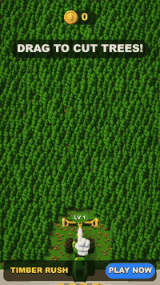
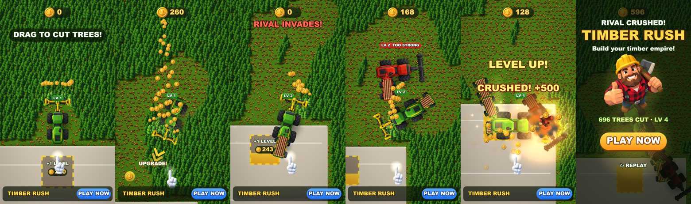

# Timber Rush — playable ad, собранный ИИ-пайплайном

**▶ Играть в браузере / с телефона:** https://bankaino.github.io/timber-rush-playable/
(A/B-варианты: [short_loop](https://bankaino.github.io/timber-rush-playable/short_loop.html) · [power_fantasy](https://bankaino.github.io/timber-rush-playable/power_fantasy.html) · [tight_timebox](https://bankaino.github.io/timber-rush-playable/tight_timebox.html))

<p align="center"></p>

Портретная playable-реклама гибрид-казуальной игры про лесозаготовку. Сделана **по мотивам рекламного креатива** (харвестер выкашивает лес, монеты, апгрейды, дуэль машин) — со своим брендом, механикой и артом. Весь путь от референса до билдов под рекламные сети пройден с ИИ-инструментами: **Claude Code** (код, архитектура, агенты-критики), **Codex / ChatGPT image gen** (весь арт), собственные тулзы для сборки и проверки.



## Что внутри за 25 секунд

| время | бит | что видит игрок |
|---|---|---|
| 0–3 с | хук | рука показывает свайп, «DRAG TO CUT TREES!» — лес начинает валиться с первого касания |
| 3–8 с | ядро | харвестер косит лес, монеты летят в счётчик, звук пилы и монеток |
| ~8 с | первая награда | на площадке базы «+1 LEVEL»: прицеп с брёвнами, машина больше, камера отъезжает |
| 9–20 с | конфликт | вторгается красный соперник: «TOO STRONG», пока ты слабее → второй апгрейд → «CRUSH IT!» |
| ~20 с | вау-момент | таран: взрыв, обломки, +500 монет |
| 22 с+ | эндкард | маскот, статистика, PLAY NOW (весь экран — CTA) |

Принципы из практики плейаблов: хук ≤ 3 с одним пальцем; первая награда ≤ 8 с; нет проигрыша (слабее → отскок, а не фейл); **кнопка стора видна всё время**; на каждое действие — отклик (тряска, частицы, звук, след в мире); бездействие 2.5 с → рука возвращается; эндкард гарантирован всем (12 с без касаний, 10 с простоя, 28 с максимум) — иначе сети не получают `gameEnd`.

## Билды под рекламные сети — одной командой

```bash
python tools/build_playable.py --variant all
```

Каждый билд — **один HTML-файл** без внешних запросов: движок, код, текстуры (WebP в base64) и адаптер сети.

| сеть | размер | лимит | CTA / жизненный цикл |
|---|---|---|---|
| AppLovin | 0.38 MB | 5 MB | MRAID `mraid.open` |
| Unity Ads | 0.38 MB | 5 MB | MRAID |
| ironSource | 0.38 MB | 5 MB | DAPI `openStoreUrl` |
| Mintegral | 0.38 MB | 5 MB | `install()`, `gameReady()`, `gameEnd()` |
| Google Ads | 0.24 MB (zip) | 5 MB | `ExitApi.exit()` |
| Meta | 0.38 MB | 2 MB | `FbPlayableAd.onCTAClick()` |

Звук выключается, когда реклама не видна (MRAID `viewableChange` / DAPI `audioVolumeChange`). Полный отчёт: [docs/build-report.md](docs/build-report.md).

## Оптимизация (было → стало)

| что | до | после | как |
|---|---|---|---|
| вес билда | 46 MB (Unity WebGL прототип) | **0.38 MB** | свой 2D WebGL2-движок без зависимостей, всё inline |
| текстуры | 6.7 MB PNG | **208 KB** | WebP ровно под размер на экране × 1.4 (`tools/build.json`) |
| лес (≈1300 деревьев на экране) | ~1100 draw calls | **1 instanced draw** | атлас, запечённый на GPU при старте + `drawArraysInstanced` (`live/batch.js`) |
| FPS на мобильном вьюпорте 390×844 | 38 | **61** | батчинг + меньше смен состояний |
| звук | — | **0 байт** | процедурный WebAudio (`live/audio.js`) |

Экран заполняется на любом телефоне: ширина вида 1080, высота следует соотношению сторон устройства (16:9 … 19.5:9).

## A/B-гипотезы

Вариант = JSON с гипотезой и переопределением параметров баланса (`variants/*.json`), билдится той же командой:

- `short_loop` — одного апгрейда хватает, чтобы раздавить соперника: вау-момент на ~9 с, эндкард на ~12 с. *Поднимает ли CTR более короткое время до кульминации?*
- `power_fantasy` — широкая быстрая пила: больше «сочности», короче поездки к площадке. *Сырая сочность против прогрессии.*
- `tight_timebox` — жёсткие 25 с и дешёвые апгрейды. *Насколько клики делает сам эндкард?*

## Как проверяется качество

- **Smoke-тест** (`tools/smoke_test.mjs`): открывает собранный HTML в мобильном вьюпорте с заглушкой MRAID, водит пальцем, проверяет — нет ошибок, нет внешних запросов, монеты начисляются, CTA вызывает `mraid.open`, FPS ≥ 50.
- **Детерминированная симуляция** (`live/sim.js`): демо-прогон проверяется headless (`SIM.demoCheck`) — все биты рекламы наступают в нужное время; экономика тюнится числами, а не на глаз.
- **QA HUD**: каждый экран HUD рендерится с худшими строками, проверяются выход текста за панель и наложения.
- **Независимые агенты-критики**: визуальный (сравнение с референсом по замерам яркости, масштаба, палитры) и геймдизайнерский (играет билд разными стратегиями как продюсер плейаблов). Их отчёты и что было исправлено: [study/critique/](study/critique/).

## ИИ-пайплайн

1. **Разбор референса** → решения: гибрид видео-хука и реального игрового цикла, своя айдентика.
2. **Арт**: style bible + промпт на каждый ассет (`art/prompts/`), генерация пачками через Codex, нарезка листов, авто-подготовка текстур. Машины — строго в плане сверху (вращаются кодом), соперник и его прицеп — правки утверждённых ассетов (только цвет). Исходники: `art/gen/`.
3. **Код**: симуляция, сцена, HUD, звук — Claude Code; живое превью с hot-reload.
4. **Проверка**: smoke-тест, QA, агенты-критики → правки → варианты → билды.

Пайплайн упакован в переиспользуемый скилл для Claude Code: новый плейабл по референсу стартует с этого шаблона, новыми остаются только механика и арт.

## Запуск локально

```bash
python -m http.server 8000      # из корня репозитория
# http://localhost:8000/live/index.html?ad=1  — живая версия (рекламный режим)
# http://localhost:8000/live/index.html       — авто-демо (attract), любое касание — играть
python tools/build_playable.py --variant all --pages docs   # билды + демо для GitHub Pages
node tools/smoke_test.mjs dist/default/applovin.html        # нужен Playwright
```

## Структура

```
live/        движок (gl.js, lib.js, batch.js), игра (sim.js, scene.js), звук, index.html
tools/       build_playable.py, build.json (текстуры, стор), smoke_test.mjs
variants/    A/B-гипотезы
art/         style bible, промпты, сгенерированные исходники
study/       отчёты агентов-критиков
docs/        демо для GitHub Pages, медиа, отчёт по билдам
```

*Референс — чужой рекламный креатив, в репозиторий не включён. Название, бренд и весь арт — свои; ссылки на стор — заглушки.*
